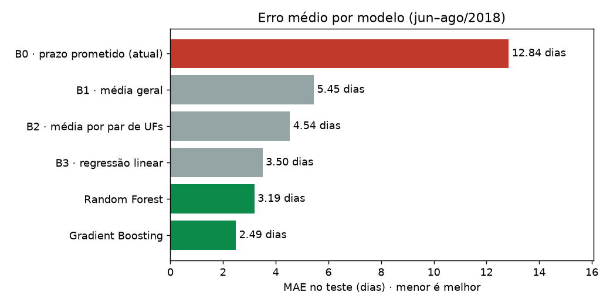

# WayHub + OptiRoute AI

Projeto semestral · Isadora Marques Gonçalves · João Pedro Propércio · Bruno Ambrósio

O projeto tem duas partes que funcionam juntas:

- **WayHub** (a plataforma): "carona de cargas" entre Centros Logísticos, inspirada na BlaBlaCar. Um centro publica
  pedidos, um motorista que já vai viajar entre duas cidades leva esses pedidos e recebe uma pequena taxa por eles.
- **OptiRoute AI** (o núcleo inteligente): modelo de **Aprendizado de Máquina Supervisionado** que prevê em quantos dias
  um pacote chega ao destino. Ele é servido pela API do WayHub e usado na tela **Previsão de prazo** do painel do Centro.

> Hoje o prazo de entrega é definido no chute: tabelas fixas, intuição ou dias "por garantia".
> O OptiRoute aprende com entregas reais e erra **81% menos** que o prazo prometido atualmente.

## Entrega 2 · Modelo supervisionado e validação

| O que foi pedido | Onde está |
|---|---|
| Modelos supervisionados treinados e justificados | [ml/train.py](ml/train.py) · relatório, seção 3 |
| Separação de treino, validação e teste sem vazamento | Divisão **temporal** pela data de postagem · relatório, seção 2 |
| Métricas e justificativa da principal | MAE (principal), ME, RMSE e % de atraso · relatório, seção 4 |
| Comparação com a linha de base do Ciclo 1 | B0–B3 contra os modelos · relatório, seção 5 |
| Análise de erros, limitações e sobreajuste | Por região, distância e mês, importância das variáveis · relatório, seções 6 e 7 |
| Aplicação web consumindo o modelo por API | `POST /api/predict/transit` + tela **Previsão de prazo** |

📄 **Relatório completo:** [ml/reports/relatorio.md](ml/reports/relatorio.md) (gráficos em [ml/reports/figs/](ml/reports/figs/))

### Resultado no teste (jun–ago/2018, meses que o modelo nunca viu)

| Modelo | MAE (dias) | Observação |
|---|---|---|
| B0 · prazo prometido pela loja (método atual) | 12,85 | erro defensivo: promete ~12 dias a mais |
| B1 · média geral | 5,45 | |
| B2 · média por par de estados | 4,54 | |
| B3 · regressão linear | 3,50 | melhor linha de base |
| Random Forest | 3,19 | |
| **Gradient Boosting (escolhido)** | **2,49** | **29% menos erro que a melhor linha de base** |

Além do tempo esperado, o modelo calcula um **prazo seguro** (quantil de 90%). Com ele, **96%** das entregas chegam
dentro do prazo prometendo em média **12,4 dias**, contra 18,3 dias do método atual (94% no prazo).



**Dados:** [Brazilian E-Commerce Public Dataset by Olist](https://www.kaggle.com/datasets/olistbr/brazilian-ecommerce)
(Kaggle). São ~100 mil compras reais de 2016 a 2018, e 94.703 entregas sobraram após a limpeza.

## Estrutura

```
backend/            API Flask + SQLite (regras, autenticação, rota de previsão)
  app.py            rotas da API e entrega do site
  rules.py          taxa da carona, mínimo de R$ 5,00, prazo de 40 min, códigos
  predictor.py      carrega o modelo treinado e faz a previsão
  seed.py           dados de demonstração
  tests/            testes automatizados
frontend/           site (HTML/CSS/JS puro): app do motorista e painel do centro
ml/                 OptiRoute AI
  features.py       variáveis do modelo (compartilhado entre treino e API)
  train.py          treino, validação, comparação com as linhas de base, relatório
  models/           modelo treinado (transit_model.joblib)
  reports/          relatório, métricas (metrics.json) e gráficos
  data/             CSVs da Olist (não incluídos, veja abaixo)
docs/ARQUITETURA.md modelo de dados, regras de negócio e rotas da API
```

## Como rodar

Requisitos: Python 3.10 ou mais recente (testado no 3.15).

```bash
pip install -r backend/requirements.txt
```

```bash
cd backend
python seed.py        # dados de demonstração (centros, motorista e pedidos)
python app.py         # abre em http://localhost:5000
```

O modelo treinado já vem em `ml/models/`, então **não é preciso treinar** para usar a aplicação.

Contas demo (senha `wayhub123`):

| Perfil | E-mail |
|---|---|
| Centro Logístico | `hub.anapolis@wayhub.com`, `hub.goiania@wayhub.com`, `hub.brasilia@wayhub.com` … |
| Motorista | `motorista@wayhub.com` (veículo e documentos já aprovados) |

Os pedidos de demonstração vencem em até 3 dias. Para recriá-los, apague `backend/data/wayhub.db` e rode `python seed.py` de novo.

### Demonstração da previsão (Machine Learning)

1. Entre como `hub.anapolis@wayhub.com` e abra **Previsão de prazo**.
2. O CEP de origem já vem preenchido com o do centro. Informe um CEP de destino, por exemplo `01310-100` (São Paulo) ou `69005-000` (Manaus).
3. Clique em **Prever prazo**. A tela mostra o tempo esperado, o prazo seguro e a média histórica da rota.

A mesma previsão pode ser feita direto pela API:

```bash
curl -X POST http://localhost:5000/api/predict/transit -H "Content-Type: application/json" -d "{\"origin_cep\":\"75110-000\",\"dest_cep\":\"69005-000\",\"weight_kg\":1,\"height_cm\":20,\"width_cm\":20,\"length_cm\":20}"
```

### Treinar o modelo de novo (opcional)

1. Baixe o dataset da Olist no Kaggle (link acima) e extraia os CSVs em `ml/data/`.
2. Rode o treino. Leva cerca de 2 minutos e regenera o modelo, o relatório e os gráficos:

```bash
cd ml
python train.py
```

### Roteiro de teste da carona (WayHub)

1. Entre como **motorista**, busque *Anápolis ➔ Goiânia*, adicione pedidos até passar de R$ 5,00 e clique em **Confirmar carona**. Anote o **Código 1**.
2. Em outra janela anônima, entre como `hub.anapolis@wayhub.com` → **Acompanhamento**. O pedido aparece como *Solicitado*. Valide o Código 1 e o status muda para *Em Andamento*.
3. No app do motorista (**Viagens**), o **Código 2** aparece.
4. Entre como o centro de destino (ex.: `hub.goiania@wayhub.com`) e valide o Código 2. O status vira *Encerrado* e o pagamento é liberado.

## Testes

```bash
cd backend
python -m unittest discover tests
```

São 10 testes: regras de negócio, o fluxo completo da carona e a rota de previsão.

## Variáveis de ambiente

| Variável | Padrão | Uso |
|---|---|---|
| `WAYHUB_SECRET` | `dev-secret-troque-em-producao` | Assina o JWT e as URLs de documentos. **Troque em produção.** |
| `WAYHUB_DB` | `backend/data/wayhub.db` | Caminho do banco |
| `WAYHUB_STORAGE` | `backend/data/private_storage` | Pasta privada de uploads |
| `PORT` | `5000` | Porta HTTP |
