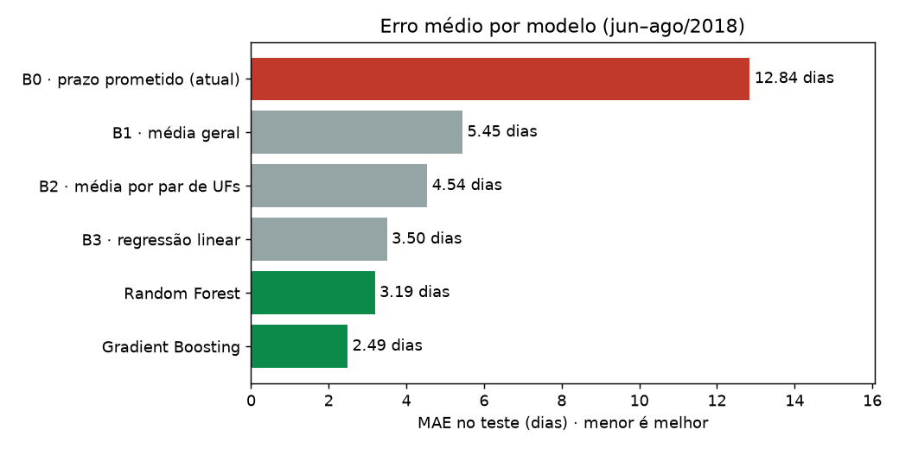
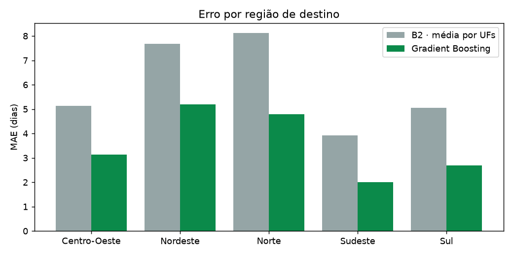
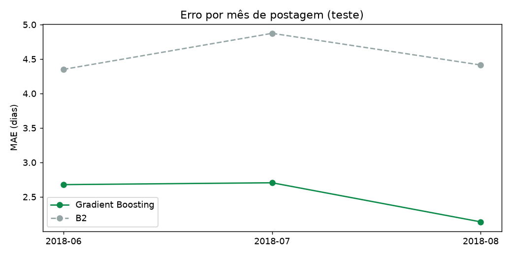
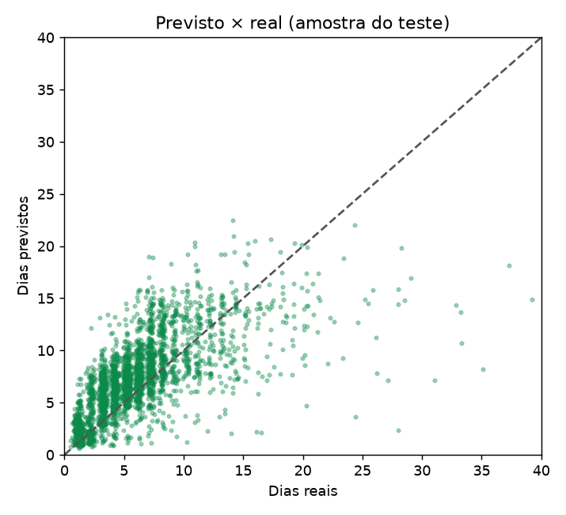
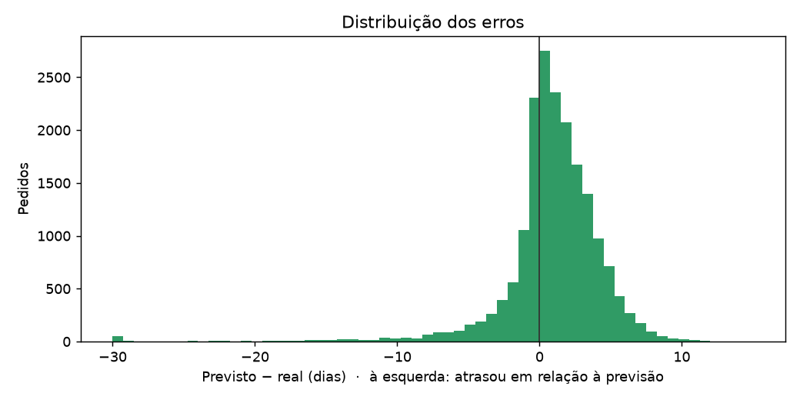
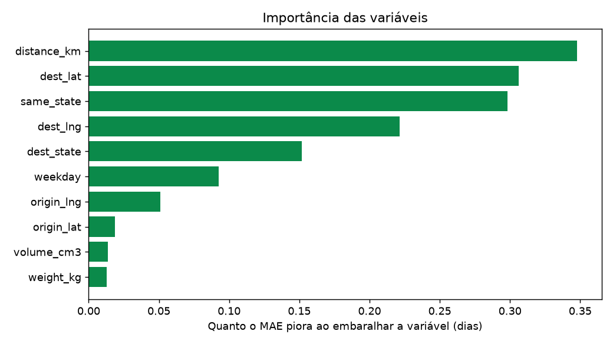

# OptiRoute AI · Entrega 2: modelo supervisionado e validação

**Grupo:** Isadora Marques Gonçalves · João Pedro Propércio · Bruno Ambrósio

> Gerado automaticamente por `ml/train.py`. Os números abaixo vêm do último treino.

## 1. Problema e alvo

Prever o **tempo de trânsito** de um pedido, em dias, entre a **postagem** (entrega à transportadora) e a **chegada ao cliente**.
É uma **regressão supervisionada**: cada pedido histórico da Olist já tem a resposta certa (quantos dias levou).

Só usamos o que se sabe no momento da postagem: UF e coordenadas de origem e destino (pelo prefixo do CEP), distância,
peso, volume, quantidade de itens, mês e dia da semana. O prazo prometido, a data de entrega e a avaliação do cliente
**não entram** como variáveis, porque seriam informação do futuro (vazamento).

## 2. Organização dos dados

| Etapa | Pedidos |
|---|---|
| Pedidos na base | 99.441 |
| Entregues e com todas as datas | 96.469 |
| Um único vendedor e peso/volume conhecidos | 95.178 |
| CEP de origem e destino com coordenada | 94.707 |
| Sem tempos negativos (erro de sistema) | 94.703 |

Mantivemos os atrasos muito longos (outliers): entender por que uma entrega demora é justamente o objetivo.

**Divisão temporal** (pela data de postagem, nunca aleatória):

| Conjunto | Período | Pedidos | Média real (dias) | Uso |
|---|---|---|---|---|
| Treino | 2016-10-08 a 2018-02-28 | 55.605 | 10.1 | o modelo aprende |
| Validação | 2018-03-01 a 2018-05-30 | 20.435 | 10.4 | escolher algoritmo e hiperparâmetros |
| Teste | 2018-06-01 a 2018-08-31 | 18.661 | 6.0 | nota final, usado **uma única vez** |

Depois de escolher o modelo na validação, ele é re-treinado com treino + validação e avaliado no teste.
Assim simulamos a vida real: o modelo prevê meses que nunca viu.

**Atenção à mudança no tempo:** no período de teste as entregas ficaram bem mais rápidas (média de
6.0 dias, contra 10.1 no treino). A Olist melhorou a logística em meados de 2018, e a
validação inclui a greve dos caminhoneiros (maio/2018), que deixou tudo mais lento. Por isso o MAE do teste é *menor* que o da validação:
o período é mais "fácil", não é o modelo que piorou ou melhorou. **Os modelos só devem ser comparados dentro do mesmo período.**
Uma divisão aleatória esconderia esse efeito e daria uma nota otimista demais.

## 3. Modelos e justificativa

- **Random Forest**: média de muitas árvores de decisão. É robusto a outliers e captura relações não lineares,
  como "a mesma distância demora mais para o Norte que para o Sul".
- **Gradient Boosting (HistGradientBoosting)**: árvores em sequência, cada uma corrigindo o erro da anterior.
  Costuma ser o mais preciso em dados tabulares, trata as UFs como categoria e treina rápido em ~100 mil linhas.
  Testamos também a perda `absolute_error`, que otimiza diretamente o MAE, a nossa métrica principal.

Hiperparâmetros testados na validação (os 6 melhores de 12):

| modelo | params | MAE_treino | MAE_validacao | gap |
|---|---|---|---|---|
| Gradient Boosting | loss=absolute_error, learning_rate=0.1, max_leaf_nodes=31 | 3.68 | 4.99 | 1.31 |
| Gradient Boosting | loss=squared_error, learning_rate=0.05, max_leaf_nodes=31 | 4.06 | 4.99 | 0.93 |
| Gradient Boosting | loss=absolute_error, learning_rate=0.05, max_leaf_nodes=31 | 3.82 | 4.99 | 1.17 |
| Random Forest | max_depth=12, min_samples_leaf=20 | 3.93 | 4.99 | 1.06 |
| Gradient Boosting | loss=absolute_error, learning_rate=0.05, max_leaf_nodes=63 | 3.69 | 5.00 | 1.30 |
| Random Forest | max_depth=12, min_samples_leaf=5 | 3.77 | 5.00 | 1.23 |

**Escolhido: Gradient Boosting** (menor MAE na validação).

## 4. Métricas

- **MAE (principal)**: "em média, erramos o prazo por quantos dias?". Está na unidade do negócio, é fácil de explicar
  ao lojista e não é dominada por poucos atrasos extremos.
- **ME (erro com sinal, previsto − real)**: positivo indica folga demais (perde vendas); negativo indica que promete rápido demais (atrasa).
- **RMSE**: pune erros grandes. Mostra o risco de atrasos que quebram contratos.
- **% de atraso**: fração das entregas que chegariam depois do prazo previsto.

## 5. Comparação com a linha de base

**Validação (mar–mai/2018)**, com modelos treinados só no treino:

| modelo | MAE | ME | RMSE | atraso_pct |
|---|---|---|---|---|
| B0 · prazo prometido (atual) | 11.48 | 9.10 | 13.70 | 12.86 |
| B1 · média geral | 6.79 | -0.37 | 9.54 | 37.86 |
| B2 · média por par de UFs | 5.22 | -0.79 | 8.03 | 39.58 |
| B3 · regressão linear | 5.56 | -1.03 | 8.51 | 39.41 |
| Random Forest | 4.99 | -1.50 | 8.15 | 41.65 |
| Gradient Boosting | 4.99 | -2.73 | 8.57 | 50.36 |

**Teste (jun–ago/2018)**, com modelos re-treinados em treino + validação. É a nota final:

| modelo | MAE | ME | RMSE | atraso_pct |
|---|---|---|---|---|
| B0 · prazo prometido (atual) | 12.84 | 12.27 | 15.60 | 5.55 |
| B1 · média geral | 5.45 | 4.12 | 6.56 | 12.60 |
| B2 · média por par de UFs | 4.54 | 3.59 | 5.86 | 12.71 |
| B3 · regressão linear | 3.50 | 2.21 | 5.02 | 17.26 |
| Random Forest | 3.19 | 2.05 | 4.67 | 15.07 |
| Gradient Boosting | 2.49 | 0.87 | 4.26 | 30.11 |

- O **Gradient Boosting** erra em média **2.49 dias**. É **29% menos** que a melhor linha de base
  (B3 · regressão linear, 3.50 dias) e **81% menos** que o prazo prometido hoje (B0, 12.84 dias).
- Nos **dois** períodos, os modelos de ML erram menos que todas as linhas de base. O ganho não depende de um período específico.
  Na validação, Random Forest e Gradient Boosting praticamente empatam. Com a greve a vantagem sobre as bases é menor,
  porque um evento externo domina o erro, e o ME fica **negativo**: os modelos prometeram rápido demais,
  já que nada no histórico indicava a greve.
- O B0 tem ME de **+12.3 dias**: é o "erro defensivo". Quase nunca atrasa, mas promete muito mais tempo do que precisa.
- Todos os modelos têm ME positivo no teste: aprenderam com um passado mais lento e ficaram um pouco "pessimistas".
  É o efeito da mudança no tempo, e por isso é preciso re-treinar periodicamente.
- Um modelo que mira o MAE erra para os dois lados, então cerca de 30% das entregas chegariam depois do valor
  previsto. Por isso ele é o **tempo esperado**, não o prazo a prometer. Para prometer, usamos o quantil de 90%:

| prazo | chega_no_prazo_pct | folga_media_dias | prazo_medio_dias |
|---|---|---|---|
| B0 · prazo prometido (atual) | 94.45 | 12.27 | 18.32 |
| Modelo · prazo seguro (P90) | 96.10 | 6.33 | 12.38 |

O **prazo seguro (P90)** mantém a maioria das entregas dentro do prazo prometendo bem menos dias que o B0.
É o valor prático para o lojista.

## 6. Validação e análise de erros

**Sobreajuste.** A coluna `gap` da tabela de hiperparâmetros (MAE validação − MAE treino) mostra quanto o modelo
"decorou" o treino. Árvores mais profundas e folhas menores aumentam o gap. Por isso escolhemos pela validação, e não pelo treino.
Parte do gap também vem da mudança no tempo: a validação inclui a **greve dos caminhoneiros (maio/2018)**,
que nenhum dado de treino poderia antecipar.

**Por região de destino:**

| region | n | MAE_modelo | MAE_B2 | ME_modelo |
|---|---|---|---|---|
| Nordeste | 1666 | 5.18 | 7.68 | 1.68 |
| Norte | 302 | 4.78 | 8.12 | 2.25 |
| Centro-Oeste | 1027 | 3.14 | 5.14 | 1.49 |
| Sul | 2452 | 2.70 | 5.05 | 1.25 |
| Sudeste | 13214 | 2.00 | 3.92 | 0.62 |

**Por distância:**

| dist_bin | n | MAE_modelo | MAE_B2 | ME_modelo |
|---|---|---|---|---|
| até 100 km | 4205 | 1.18 | 3.31 | -0.26 |
| 100–300 km | 2627 | 1.82 | 2.69 | 0.68 |
| 300–700 km | 6552 | 2.56 | 4.67 | 1.23 |
| 700–1500 km | 3647 | 3.34 | 5.68 | 1.17 |
| > 1500 km | 1630 | 4.76 | 7.59 | 2.02 |

**Por mês de postagem:**

| mes | n | MAE_modelo | MAE_B2 | ME_modelo |
|---|---|---|---|---|
| 2018-06 | 5931 | 2.68 | 4.35 | 0.38 |
| 2018-07 | 5866 | 2.70 | 4.87 | 1.07 |
| 2018-08 | 6864 | 2.14 | 4.41 | 1.13 |

**Onde o modelo mais erra:**
- O erro cresce com a distância e é maior para **Nordeste** (5.2 dias),
  onde há menos pedidos para aprender e a logística é mais irregular.
- Nos 5% piores erros, a participação por região é: Nordeste 43%, Sudeste 33%, Sul 10%, Norte 8%, Centro-Oeste 6%.
  No total do teste, é: Sudeste 71%, Sul 13%, Nordeste 9%, Centro-Oeste 6%, Norte 2%. Ou seja, Norte e Nordeste aparecem muito mais entre os piores erros do que no volume total.
- 0.5% das entregas do teste levaram mais de 30 dias. São extravios, greves e problemas que nenhuma variável da
  postagem antecipa, e geram os maiores erros e o RMSE alto.

**O que o modelo aprendeu** (importância por permutação: quanto o MAE piora ao embaralhar cada variável):

| variavel | aumento_MAE |
|---|---|
| distance_km | 0.35 |
| dest_lat | 0.31 |
| same_state | 0.30 |
| dest_lng | 0.22 |
| dest_state | 0.15 |
| weekday | 0.09 |
| origin_lng | 0.05 |
| origin_lat | 0.02 |

## 7. Limitações

- **Período e contexto:** dados de 2016–2018 de um único marketplace. O comportamento das transportadoras muda,
  então o modelo precisa ser re-treinado com dados recentes antes de uso real.
- **Censura no fim da base:** pedidos postados no fim de ago/2018 que demoraram muito ainda não estavam entregues
  quando a base foi extraída, e por isso ficaram de fora. O teste pode parecer um pouco mais "rápido" que a realidade.
- **Sem informação de transportadora, modal ou clima:** os grandes atrasos ficam sem explicação.
- **Precisão geográfica:** usamos o centro do prefixo de 5 dígitos do CEP, e não o endereço exato.
- **Escala do WayHub:** a Olist mede entregas interestaduais em dias. As caronas do WayHub entre centros próximos
  (ex.: Anápolis ➔ Goiânia) levam horas, então a previsão no app representa o prazo do envio tradicional usado como referência.

## 8. Integração com a aplicação

O modelo salvo (`ml/models/transit_model.joblib`) é carregado pela API Flask do WayHub:
`POST /api/predict/transit` recebe CEP de origem, CEP de destino, peso, dimensões e data, e devolve o tempo esperado,
o prazo seguro (P90) e a comparação com a média histórica da rota. A tela **Previsão de prazo** do painel do Centro consome essa rota.
